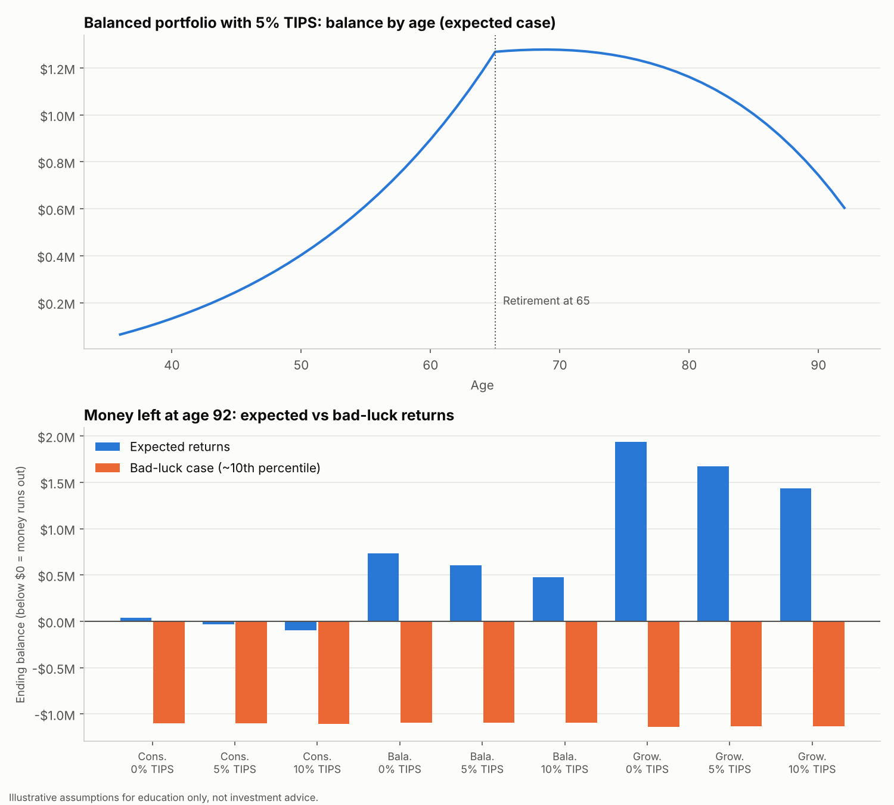
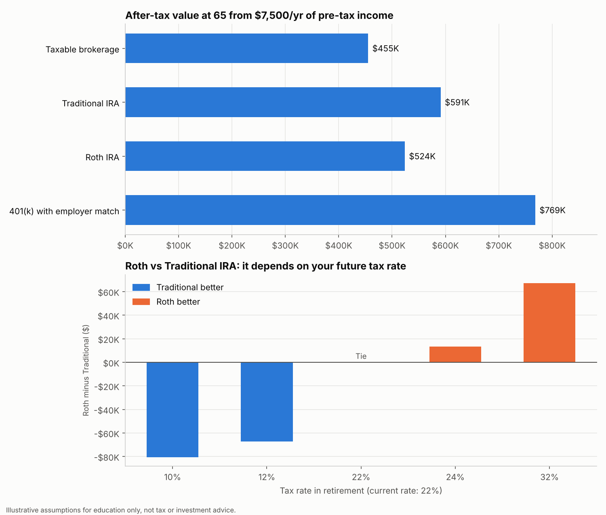
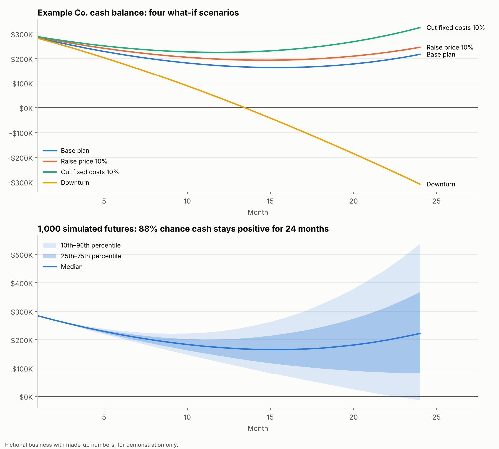
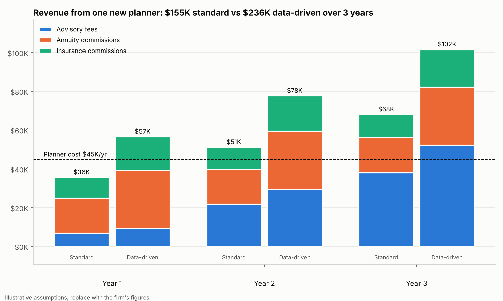

# Retirement Portfolio Stress Test Model

A formula-driven Excel model, built in the FMVA (Financial Modeling & Valuation Analyst) style, that answers the question behind every retirement plan: **"Will my money last, even if markets disappoint?"**

It projects a client's savings from today through retirement, compares 3 model ETF portfolios with 0%, 5% and 10% sleeves of inflation-protected bonds (TIPS), and stress-tests every combination against a bad-luck market.

**Try it live:** [Client Planning Lab](https://m-nova288.github.io/retirement-stress-test-model-/planner/), an interactive version with sliders and a Monte Carlo probability of success. Or scan:




## What the model shows

Example client: age 35, $50K saved, $12K/yr contributions, retiring at 65, planning to 92.

| Portfolio | TIPS sleeve | Net return | Volatility | Balance at 65 | Left at 92 (expected) | Bad-luck case: money runs out at |
|---|---|---|---|---|---|---|
| Balanced | 0% | 4.7% | 10.0% | $1.29M | $0.74M | age 82 |
| Balanced | 10% | 4.5% | 9.2% | $1.25M | $0.48M | age 82 |
| Growth | 0% | 5.4% | 13.6% | $1.46M | $1.94M | age 81 |

**Key insight:** shifting the mix toward safer assets smooths the ride (lower volatility) but costs some expected growth, and in a bad-luck market (about a 10th-percentile outcome) **every portfolio runs out of money around age 81–82**. The investment mix alone doesn't protect the plan. What does, for this client:

- Raising contributions from $12K to **$21K a year**, or
- Retiring at **67 with $18K a year** in contributions, or
- Covering about **$11K a year** of spending with guaranteed income (for example, an annuity; its cost needs separate analysis)

## Where should the next dollar go? Account comparison

The same client sets aside $7,500 a year of pre-tax income (the 2026 IRA limit), growing 3% a year, in four account types, all earning the same portfolio return.



| Account | Tax treatment | After-tax value at 65 | vs taxable |
|---|---|---|---|
| 401(k) with employer match | Tax break now, 50% match on first 6% of salary, withdrawals taxed | $769K | +$313K |
| Traditional IRA | Tax break now, withdrawals taxed | $591K | +$136K |
| Roth IRA | Taxed now, withdrawals tax-free | $524K | +$69K |
| Taxable brokerage | Taxed now, gains taxed yearly and at sale | $455K | baseline |

**Key insights**
- **Capture the employer match first.** It's an instant 50% return and beats every other option by a wide margin.
- **Any tax-advantaged account beats a taxable one**, by $69K to $136K here.
- **Roth vs Traditional depends on your future tax rate:** Traditional wins if your rate drops in retirement (22% now → 12% later in this example), Roth wins if it rises, and they tie exactly when it stays the same.

Method: equal pre-tax income goes into each account, so Roth and taxable contributions are reduced by the 22% tax first. Taxable accounts lose 0.5% a year to tax on dividends, and gains are taxed at 15% at retirement. Texas has no state income tax.

## Business cash-flow simulation (for business-owner clients)

A fictional small business, **Example Co.** (made-up numbers), modeled the way a business owner's planner or finance team would: customers × price, less costs, month by month.



| Scenario | Breakeven month | Cash runs out | Cash at month 24 |
|---|---|---|---|
| Base plan | 16 | No | $217K |
| Raise price 10% (churn +0.5 pt) | 16 | No | $246K |
| Cut fixed costs 10% | 13 | No | $325K |
| Downturn (growth 1%, churn 4%) | Never | Month 14 | −$308K |

**Monte Carlo simulation:** 1,000 runs, each with its own underlying growth and churn rate plus month-to-month noise.
- **88% chance** the business stays cash-positive for all 24 months
- **75% chance** it reaches a profitable month
- Ending cash ranges from about −$14K (bad case, 10th percentile) to $537K (good case, 90th percentile), with a typical outcome of $222K

**Key insight:** cutting fixed costs reaches breakeven 3 months sooner and leaves the most cash, while a downturn drains cash within 14 months. About 1 in 8 simulated futures runs out of money, which is why a business owner needs a cash reserve and a downturn plan, not just a growth plan.

## Practice ROI: how planning work turns into firm revenue

How one new planner's client work becomes revenue for the firm: prospects → new clients → retained clients → assets under management, earning advisory fees, annuity commissions and life insurance commissions. It compares a **standard approach** with a **data-driven approach** (stress test and live planner in client meetings) that lifts conversion, retention and product take-up.



| 3-year result | Standard | Data-driven | Difference |
|---|---|---|---|
| Total revenue | $155K | $236K | +$81K (+52%) |
| Net contribution after planner cost | $20K | $101K | +$81K |
| Clients at end of year 3 | 100 | 137 | +37 |
| Assets under management, year 3 | $4.7M | $6.4M | +$1.8M |
| Client lifetime value (10-year NPV at 8%) | $4.4K | $5.1K | +$0.7K |

**Key insight:** with identical prospects, the standard planner doesn't cover their $45K cost until year 2, while the data-driven planner is profitable in year 1. The gain comes from clients who see a clear reason to act and stay because they understand their plan.

Assumptions: 20 prospects a month; conversion 15% vs 20%; retention 92% vs 95%; $33K average assets per new client (Increase Consultants averages about $32.9K, per AdvizorPro); annuity take-up 20% vs 25% at $50K premium and 5% commission; life insurance take-up 25% vs 30% at $1,500 premium, 80% first-year and 5% renewal commission. All are illustrative and editable in the workbook.

## How it's built

| Sheet | What it does |
|---|---|
| **Dashboard** | Key outputs and two charts that update from the levers |
| **Assumptions** | Client profile, two scenario levers (portfolio 1–3, TIPS %), return and volatility by asset class, correlation and covariance matrices |
| **Scenarios** | 3 portfolios × 3 TIPS sleeves: weights, expected return, volatility (w′Σw), closed-form balance at retirement and at plan-to age, bad-luck case |
| **Projection** | Year-by-year cash flow for the selected scenario: contributions growing with raises, inflation-adjusted withdrawals net of Social Security |
| **Business Cash Flow** | 24-month driver model for a fictional business: 4 what-if scenarios in live formulas, runway and breakeven |
| **Simulation** | 1,000-run Monte Carlo of growth and churn: cash percentiles by month, chance of staying cash-positive |
| **Practice ROI** | Planner funnel to firm revenue over 3 years, standard vs data-driven, plus a 10-year client lifetime value DCF (Excel NPV) |
| **Account Comparison** | Taxable vs Traditional IRA vs Roth IRA vs 401(k) with match: after-tax value at retirement, plus a Roth-vs-Traditional sensitivity across retirement tax rates |

FMVA practices used:
- Every input in its own labeled cell; no hardcoded numbers inside formulas
- Color convention: blue inputs, black formulas, green cross-sheet links, yellow key levers
- Cross-check: the year-by-year projection matches the closed-form scenario math to the cent
- Scenario and sensitivity analysis, portfolio risk from a covariance matrix, growing-annuity math

Example ETFs per asset class: VTI (US stocks), VXUS (international stocks), BND (US bonds), SCHP (TIPS).

Bad-luck case = net return − 1.28 × volatility ÷ √30, an approximation of the 10th-percentile annualized return over 30 years.

## Run it

```bash
pip install openpyxl matplotlib numpy
python build_model.py         # writes retirement_stress_test_model.xlsx
python business_cashflow.py   # adds the business model and Monte Carlo sheets
python practice_roi.py        # adds the Practice ROI sheet
# open in Excel (formulas calculate on open), or recalculate with LibreOffice
python make_chart.py          # redraws all chart images from the calculated workbook
```

## Limitations

- Return, volatility and correlation figures are **illustrative assumptions for teaching, not forecasts**.
- Inflation is held constant, so the model understates TIPS' main benefit: protection when inflation spikes. An inflation-shock scenario is the natural next step.
- The retirement model uses constant average returns; applying the Monte Carlo approach from the business simulation to it is the natural next step.
- Account comparison uses flat tax rates and ignores income limits for Roth contributions and IRA deductions, RMDs, and Social Security taxation.

*Educational project, not investment advice.*

---
Built by **Monisa Nova** · [LinkedIn](https://linkedin.com/in/monisa-nova) · B.S. Computer Information Systems, University of Houston
